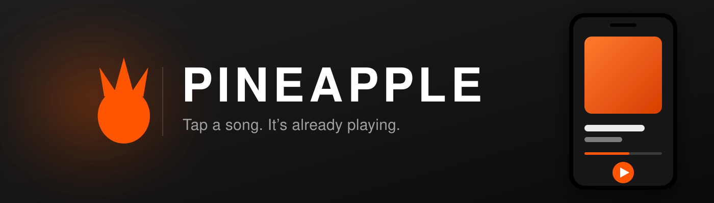

<div align="center">
  
  <h1>Pineapple</h1>
  <p><strong>A tiny Android music player that starts the song before you let go of the screen.</strong></p>
  <p>
    <a href="https://github.com/kiinshuk/pineapple/releases/latest">
      
    </a>
    <a href="https://github.com/kiinshuk/pineapple/releases">
      
    </a>
  </p>
  <p><a href="CONTRIBUTING.md">Contributing</a> · <a href="https://kiinshuk.github.io/pineapple-site/">Official website</a> · <a href="#build-locally">Build it yourself</a></p>
  <p>
    
    
    
    
  </p>
</div>

Pineapple plays YouTube music with nothing in between: search, tap, sound. It
talks to InnerTube directly from hand-written Kotlin, resolves the stream while
you are still reading the results list, and lets ExoPlayer run with no
JavaScript engine, no WebView, and no proof-of-origin token. The whole release
build is **2.1 MB**.

## Features

### Playback

- Starts immediately — the top five stream URLs are resolved while the results
  are still on screen, so there is no spinner between the tap and the audio.
- Plays continuously in the background with notification and lock-screen
  controls.
- Builds a mix of related tracks behind whatever you chose.
- No token gymnastics: it uses the one player client YouTube serves complete
  files to, which is why none of the usual machinery is here.

### Search

- Searches YouTube Music rather than YouTube, so results are releases instead
  of everything the site has ever indexed.
- **Official music only.** A result counts only when YouTube typed it as the
  track's own audio or its official video — a whitelist, not a blacklist, so
  new categories of junk stay excluded rather than leaking through.
- Falls back to user uploads rather than returning nothing, when nothing
  official matches.
- Keeps YouTube's own relevance order. Never re-sorted by view count, which
  would only promote the loudest cover.

### Discovery and library

- Opens on the current trending chart plus what you played recently.
- Liked songs, pinned releases, listening history, and your own playlists,
  persisted across restarts.
- Long-press any track, or tap its three-dot menu, for the shared actions
  sheet: add to liked, play next, add to queue, add to playlist.

### Interface

- Dark throughout — `#0B0B0D` ground, `#151518` and `#202024` surfaces, orange
  `#FF8A24` as the only accent, `#F5F5F7` text.
- Full-screen player whose background is derived from the artwork.
- Bottom tabs with a real back-stack: the system back button returns to the
  page you were on instead of closing the app.
- Every glyph is a bundled vector drawable. No icon library, no icon font, no
  bundled font resource, no PNG per density.

## Download

**[Get the latest release](https://github.com/kiinshuk/pineapple/releases/latest)**

Pineapple supports Android 8.0 (API 26) and later. Install the APK from a
source you trust — Android will ask you to allow installation from whatever you
downloaded it with.

## How it works

### The 403 that blocked playback for weeks

For a long time the app resolved a stream URL and then ExoPlayer died with a
bare `Response code: 403`. Three explanations were plausible, and all three
looked right because each reproduced *something* real.

Measured from a single IP, in the same minute, on the same video, with a fresh
URL per request:

| range | ANDROID 20.10.38 | VISIONOS 1.02 |
|---|---|---|
| no `Range` (whole file) | **403** | **200** — read all 4738365 bytes |
| `bytes=0-65535` | 206 | 206 |
| `bytes=1048576-2097151` | **403** | 206 |
| `bytes=3000000-4194303` | **403** | 206 |

The gate is the **player client that issued the URL** — not the network, not
the region, not the byte count:

- **IP binding** — real, but `src=` and `boundIp=` matched byte for byte on the
  device, and replaying the phone's own URL from a PC failed identically.
  Binding was never violated.
- **Regional gating** — false. The working URL still carries `gcr=in`.
- **A 1 MiB cap** — real, but only ever seen on ANDROID URLs, because those
  were the only ones being measured. It was an artifact of the measurement.

So `InnerTube` now leads with **`VISIONOS 1.02`** (client id `101`) and stamps
the player request with `X-Goog-Visitor-Id`. Nothing else changed — no WebView,
no JS engine, no token, no new dependency. Drop that one header and VISIONOS
answers `LOGIN_REQUIRED`; everything else in the request is optional, measured
individually. Every InnerTube response carries a visitor id, so a cold session
learns it from the search that precedes the first tap.

Proof-of-origin tokens turned out to be required by *none* of it. The working
stream URL contains no `pot` field at all. yt-dlp agrees: its default client
pool is `('visionos','web')` with no GVS PO token policy.

### Official music only

Searching YouTube returned vlogs, lyric uploads, reaction videos and podcast
episodes alongside the songs. The search path therefore queries YouTube Music
instead (client `WEB_REMIX`, id 67).

It filters with a **whitelist, not a blacklist**: a result counts only as
`MUSIC_VIDEO_TYPE_ATV` (the label's own audio) or `MUSIC_VIDEO_TYPE_OMV` (its
official video). Blacklists leak — user uploads are easy to name, but podcast
episodes arrive typed `MUSIC_VIDEO_TYPE_PODCAST_EPISODE` and videos-shelf rows
often carry no type at all. Playback still runs on VISIONOS; the music search
is only how a track gets *found*.

## Known limitations

- **The queue is not music-only yet.** `related()` still uses the plain web
  `/next`, so a continuous mix can hand you a vlog between songs.
- **Discovery's chart is a single `/browse` call.** If YouTube renames the
  explore page's shelves, the tab falls back to the first carousel it finds
  rather than erroring.
- **It will break when YouTube changes.** This is outside Google's Terms of
  Service — see [Legal](#legal).

To tell the difference between "YouTube changed something" and "something in
here broke":

```bash
python tools/probe_clients.py     # which player clients still serve files
python tools/probe_trending.py    # does Discovery's chart still parse
```

Both mirror the Kotlin parsers, so a schema change shows up as a changed column
rather than as a stack trace on a phone.

## Project structure

Pineapple is a single Gradle module — deliberately. At this size, splitting it
would cost more in wiring than it returns.

| Path | Responsibility |
|---|---|
| `youtube/InnerTube.kt` | Hand-written InnerTube client: search, browse, `/next`, player, and the client list |
| `search/` | Results and audio-stream models, plus the `HttpURLConnection` helper |
| `player/PlayerController.kt` | Thread confinement — every player call funnels through `onMain {}` |
| `playback/PlaybackService.kt` | Foreground service keeping audio alive |
| `library/` | Likes, pinned, recents and playlists — `SharedPreferences` + JSON |
| `ui/MainActivity.kt` | Scaffold, tab routing, back-stack, player bar |
| `ui/DiscoveryScreen.kt` | Trending chart and recently played |
| `ui/LibraryScreen.kt` | Library sections and the long-press actions sheet |
| `ui/NowPlayingScreen.kt` | Full-screen player, artwork-derived ground |
| `ui/components/PineappleUi.kt` | Artwork palette, thumbnails, waveform, icon set, shared controls |
| `ui/components/TrackActionsSheet.kt` | The actions sheet, shared by Search and Library |
| `di/AppModule.kt` | ExoPlayer, fetched under the player client's own user agent |
| `util/CrashLogger.kt` | Persists stack traces to storage |

```
app/src/main/res/
├── drawable/ic_launcher_foreground.xml   Vector mark — no PNGs, minSdk 26
├── drawable/ic_*.xml                     21 bundled icon vectors
├── mipmap-anydpi-v26/ic_launcher*.xml    Adaptive icon, round and square
├── values/themes.xml                     Dark window and system bars
└── xml/network_security_config.xml       HTTPS only

tools/
├── probe_clients.py                      Which player clients still serve files
└── probe_trending.py                     Does Discovery's chart still parse
```

### Deliberate decisions

- **No new dependencies.** InnerTube is written by hand rather than taken from
  NewPipeExtractor (GPLv3). HTTP is `HttpURLConnection`. Icons are bundled
  vector drawables, not an icon library.
- **Three clients, one job each.** VISIONOS for `/player`, `WEB_REMIX` for
  `/search` and `/browse`, `WEB` for `/next`. `PLAYER_CLIENTS` in
  `InnerTube.kt` is the single place to bump when YouTube rotates versions,
  and it leads with the client that works.
- **Keep YouTube's relevance order** rather than sorting by popularity.
- **Thread safety lives in `PlayerController`**, not at call sites.
- **`SharedPreferences` + JSON** for the library rather than a database — a few
  hundred rows, and it keeps the app dependency-free.
- **Always `clean assembleDebug`.** Incremental packaging once shipped ~60 MB
  of untracked bytes: a 72.6 MB APK holding 12.3 MB of entries.

## Build locally

### Requirements

- JDK 17
- Android SDK with `ANDROID_HOME` set (`compileSdk` 35, `minSdk` 26)

### Commands

```bash
./gradlew clean assembleDebug testDebugUnitTest --console=plain
```

On Windows use `gradlew.bat` with the same task names. `dev.ps1` wraps the
day to day:

```
.\dev.ps1 run | build | test | install | logs | devices | pair | clean
```

| Output | Path | Size |
|---|---|---|
| Debug | `app\build\outputs\apk\debug\app-debug.apk` | ~12.6 MB |
| Release | `app\build\outputs\apk\release\app-release.apk` | ~2.1 MB |

Release builds run R8 with resource shrinking.

```bash
./gradlew clean assembleRelease --console=plain
```

Release builds are signed with the **debug key** when `keystore.properties` is
absent, which it is on a fresh clone — deliberately, so the minified build
actually gets tested rather than assumed to work. See
[Release signing](CONTRIBUTING.md#release-signing) for doing it properly, and
note that installing a release build over an existing debug install is refused
on signature mismatch.

Lint does not gate release builds: this Android Gradle Plugin version crashes
while analysing Hilt's generated code (`NonNullableMutableLiveDataDetector`,
`IncompatibleClassChangeError`) and says outright that it is a bug in lint.
`gradlew lint` still produces the report.

### Tests

`InnerTubeParsingTest` holds **23 tests** pinning YouTube's exact response
schemas: search fields, live-stream drop, non-video skip, `lockupViewModel`
nesting, clock and count parsing, the official-music whitelist including the
podcast-episode and videos-shelf leaks, the plain-text artist fallback, and the
trending parse.

These are the safety net that matters. They cannot tell you whether music
plays — they tell you whether the parsing that *finds* music still matches what
YouTube returns, which is the part that breaks without warning.

## Contributing

Read [CONTRIBUTING.md](CONTRIBUTING.md) first. It covers the two rules that
shape everything else — **no new dependencies**, and **stability outranks
novelty** — plus how to verify playback properly (spoiler: never trust a
`Play: started` log line) and how to diagnose a broken build with the probes
in `tools/`.

Small, single-purpose pull requests are easiest to review. Say what you
verified and how.

New to the codebase? Start with an issue labelled
[`good first issue`](https://github.com/kiinshuk/pineapple/issues?q=label%3A%22good+first+issue%22).
Each one names the file and line it touches, what the change buys, and how
you will know it worked — so one can be landed in a single sitting.

## Legal

Pineapple uses YouTube's private InnerTube API without an API key, which falls
outside Google's Terms of Service. It is an independent, sideloaded project and
**cannot be published to Google Play**. It is not affiliated with, endorsed by,
or connected to YouTube, Google, or their affiliates. The same technique is
used by NewPipe.

It will break whenever YouTube changes its response shapes or client
requirements — that is the nature of the thing, and the probes above exist to
tell you when.

Pineapple is licensed under the MIT License. See [LICENSE](LICENSE).

---

Maintained by [kiinshuk](https://github.com/kiinshuk).
